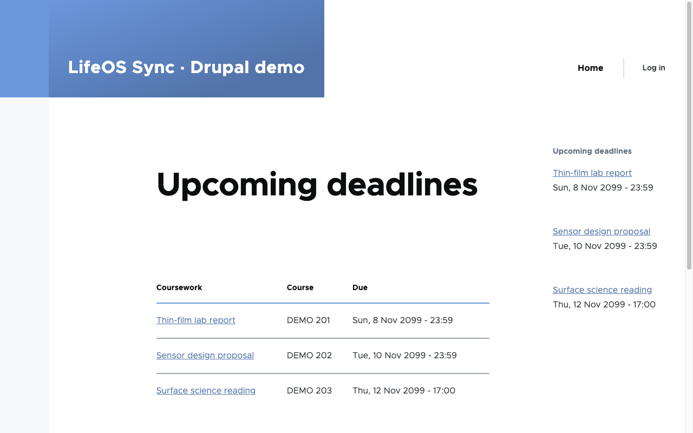
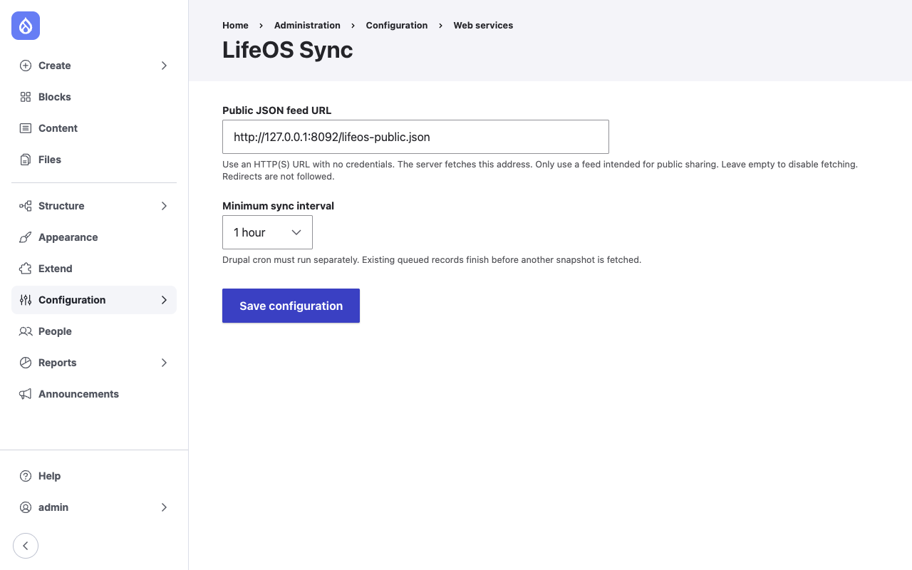

# LifeOS Sync for Drupal

[](https://github.com/jackaI1/drupal-lifeos-sync/actions/workflows/ci.yml)

A working Drupal **10.3+ / 11** custom module by Jack Lai that imports schedule items and coursework deadlines from a public JSON feed into a `lifeos_item` content type. Cron and Drush share an idempotent Queue API pipeline. Drupal Views supplies an **Upcoming deadlines** page and reusable block.

This public, reproducible development demonstration uses **fictional data**. It does not read Jack's private LifeOS workspace. The repository is public; the Drupal site runs locally using the steps below.



## Run the demo

Requires Docker Engine with Compose v2 (Docker Desktop or another compatible runtime). The first build downloads Drupal and compiles PHP extensions.

```bash
git clone https://github.com/jackaI1/drupal-lifeos-sync.git
cd drupal-lifeos-sync
docker compose up --build
```

Open **http://localhost:8080/upcoming-deadlines** after the install finishes. The demo installs Drupal 11 with Olivero, enables `lifeos_sync`, imports two schedule items and three coursework deadlines, and places the Views block in the sidebar. Dates deliberately use **2099** so the fixture remains upcoming.

- Demo login: `admin` / `demo-local-only` at `/user/login`.
- Settings: `/admin/config/services/lifeos-sync`.
- Imported nodes: `/admin/content`; individual records show the imported fields.
- Views configuration: `/admin/structure/views/view/lifeos_upcoming`.
- Set `DEMO_ADMIN_PASSWORD` before the **first** install to choose a different local demo password. The port binds to loopback. These demo credentials are not a production deployment recipe.

```bash
# Fetch and import immediately (safe to repeat).
docker compose exec drupal vendor/bin/drush lifeos:sync --force

# Exercise producer and worker separately.
docker compose exec drupal vendor/bin/drush lifeos:sync --force --enqueue-only
docker compose exec drupal vendor/bin/drush queue:run lifeos_sync

# Cron enqueues when the configured interval has elapsed, then runs the worker.
docker compose exec drupal vendor/bin/drush cron

# Stop the demo, preserving its database and site files.
docker compose down

# Reset only this Compose project's demo data (destructive to demo volumes).
docker compose down --volumes
```

The demo starts no persistent host workers. In an ongoing deployment, schedule `drush cron` with the host scheduler; the module's interval is a minimum fetch interval, not a scheduler of its own. The Compose demo does not install a background cron daemon.

## Install into an existing Drupal site

Use Drupal 10.3+ or 11, with Node, Datetime and Views; Drush **13** is required only for the CLI command. The module itself requires PHP 8.1+ on Drupal 10, while this repository's demo/test toolchain uses PHP 8.3+.

1. Copy `lifeos_sync/` into `web/modules/custom/lifeos_sync/`.
2. Run `vendor/bin/drush en lifeos_sync -y`.
3. Grant **Administer LifeOS Sync** only to trusted administrators, and configure an HTTP(S) public feed URL and interval under Configuration → Web services → LifeOS Sync. An empty URL disables new fetches.
4. Run `vendor/bin/drush lifeos:sync --force`, or run cron.
5. Visit `/upcoming-deadlines`. Place **Upcoming deadlines** through Block layout for your chosen theme. The standalone module defines the block; only the demo setup places it automatically.



## Public feed contract and LifeOS provenance

[`fixtures/lifeos-public.json`](fixtures/lifeos-public.json) is an authored public fixture, **not an existing LifeOS API response**. Its `tasks` and `timeZone` mirror the reduced coursework export in [lifeos-open's Microsoft 365 integration](https://github.com/jackaI1/lifeos-open/blob/main/integrations/m365/src/lifeos-source.ts). The added `schedule` list mirrors calendar-event data's `start.dateTime`, `end.dateTime`, `location` and `status` in [local-calendar.mjs](https://github.com/jackaI1/lifeos-open/blob/main/src/cloud/local-calendar.mjs). This module defines the combined envelope. It does not add a public endpoint to LifeOS.

The `feed` container serves the fixture at `http://feed/lifeos-public.json` inside the Compose network. A public raw copy is available [from this repository](https://raw.githubusercontent.com/jackaI1/drupal-lifeos-sync/main/fixtures/lifeos-public.json) after merge; that URL can be entered in the settings form on another Drupal site.

```json
{
  "timeZone": "America/Toronto",
  "schedule": [{
    "id": "workshop-1", "title": "Demo workshop", "status": "confirmed",
    "start": {"dateTime": "2099-11-06T10:45:00-05:00"},
    "end": {"dateTime": "2099-11-06T11:30:00-05:00"},
    "location": "Demo lab"
  }],
  "tasks": [{
    "id": "report-1", "title": "Demo report", "status": "todo",
    "courseCode": "DEMO 201", "dueAt": null, "dueDate": "2099-11-08"
  }]
}
```

Both lists and a valid `timeZone` are required. IDs are unique within each kind, up to 200 characters; titles and imported text fields are at most 255 characters. Text is displayed through Drupal field formatters with normal escaping.

| Source | Drupal field / behavior |
| --- | --- |
| `id` | `field_lifeos_id`, prefixed `task:` or `schedule:`; stable lookup identity |
| collection | `field_lifeos_kind` (`task` or `schedule`) |
| `title` | Node title |
| task `dueAt` | `field_lifeos_when`, converted to UTC |
| task `dueDate` when no `dueAt` | End of day, 23:59:59 in `timeZone`, converted to UTC |
| schedule `start.dateTime`, `end.dateTime` | `field_lifeos_when`, `field_lifeos_end`, converted to UTC |
| `courseCode`, `location`, `status` | `field_lifeos_course`, `field_lifeos_location`, `field_lifeos_status` |
| done/completed/cancelled/archived status | Unpublished; reopening republishes the same node |
| Undated task | Imported without a date; excluded from upcoming deadlines |

Task statuses: `todo`, `in_progress`, `blocked`, `done`, `completed`, `cancelled`, `archived`. Schedule statuses: `confirmed`, `cancelled`. Timestamps require seconds and an explicit `Z` or numeric offset. Impossible dates, duplicate IDs and invalid records reject the whole snapshot. Extra source fields such as `estimatedMinutes` and `courseTitle` are allowed but not stored.

## How it works

```text
Public JSON → FeedClient → FeedNormalizer → SyncManager → Drupal database queue
                                                         ↓
                            Upcoming Views ← lifeos_item nodes ← QueueWorker → Importer
```

- `hook_cron()` calls the injected producer service; Drupal cron then spends up to 30 seconds processing the worker.
- `lifeos:sync` uses the same producer and worker. `--force` bypasses the interval; `--enqueue-only` leaves jobs for cron or `queue:run`.
- Feed validation happens before queue insertion. The producer uses a lock and a database transaction. Pending jobs block another snapshot, preventing repeated backlog growth. The supported backend is Drupal's default **DatabaseQueue**; replacing it with a remote queue needs a corresponding transaction strategy.
- The importer locks each source ID and updates the same node. Replays do not create duplicates or save unchanged entities. Failures leave queue records available for retry.
- HTTP fetching permits only HTTP(S), disables redirects, sets connection/read timeouts, and limits responses to **1 MiB / 500 records**. Only trusted administrators can choose the address; their choice authorizes a server-side request, including local addresses needed by the demo. Logs omit feed URLs and response bodies.
- Views filters published coursework with dates at or after now, sorts by deadline, paginates the page at ten, and limits the block to five. Views caching is disabled so time-based results remain current.

Omitted records are **retained**, because absence alone does not prove deletion. Use explicit terminal statuses to hide them. Keep IDs stable for one feed source; switching to an unrelated source can update colliding IDs. The importer owns imported fields and publication state, so edit the source instead of hand-editing those node fields. A failed record blocks newer snapshots until the underlying problem is repaired and the queue retried. No private-feed authentication, attachments, two-way sync or automatic deletion is implemented.

## Test and develop without Docker

Requires PHP 8.3+, Composer 2, SQLite, GD, XML, mbstring, curl, zip and intl. On macOS, `brew install php composer` supplies the local toolchain. No PHP service needs to be started through Homebrew.

```bash
composer install
mkdir -p web/modules/custom
ln -s "$PWD/lifeos_sync" web/modules/custom/lifeos_sync
vendor/bin/phpcs --standard=phpcs.xml.dist
vendor/bin/phpunit -c phpunit.xml.dist
scripts/smoke.sh
```

The smoke script installs a disposable local site under `.demo/`, fetches the fixture, tests Drush/queue/cron, requests the real Views page/block, and checks anonymous settings access is forbidden. It stops both owned HTTP processes on exit, including failures. Ports default to 8093/8094 and can be changed with `LIFEOS_FIXTURE_PORT` and `LIFEOS_SITE_PORT`. Repeated runs preserve the disposable site. Remove `.demo/` and the generated `web/sites/default/settings.php` to start over with a fresh database.

To inspect that native demo interactively, run a fixture server from the repository root and keep its terminal open, then run Drupal's server from **inside `web/`** in a second terminal:

```bash
php -S 127.0.0.1:8093 -t fixtures
# Second terminal, repository root:
cd web
php -S 127.0.0.1:8094 -t "$PWD" "$PWD/.ht.router.php"
```

Open http://127.0.0.1:8094. Stop both servers with Ctrl-C when finished. If using different fixture ports, update the feed URL in settings.

[GitHub Actions](.github/workflows/ci.yml) resolves and tests Drupal 10 and 11 separately on PHP 8.3, runs **Drupal + DrupalPractice PHPCS**, PHPUnit kernel tests and a full install/HTTP smoke. A separate job builds and tests the locked Docker demo. Kernel coverage includes entity replay/update, terminal status visibility, date validation/timezones, duplicate IDs, interval/backlog/fetch failure behavior, and actual Views queries.

## Skills demonstrated

| Skill | What it does | Implementation paths |
| --- | --- | --- |
| Drupal 10/11 custom modules and PHP OOP | Defines the module, content type and imported fields | `lifeos_sync/lifeos_sync.info.yml`, `lifeos_sync/config/install/node.type.lifeos_item.yml` |
| Form API and configuration | Edits feed URL/interval with permission checks and schema | `lifeos_sync/src/Form/SettingsForm.php`, `lifeos_sync/config/schema/lifeos_sync.schema.yml`, `lifeos_sync/lifeos_sync.permissions.yml` |
| Dependency injection and Drush | Shares services between Drupal and a CLI import command | `lifeos_sync/lifeos_sync.services.yml`, `lifeos_sync/src/Drush/Commands/LifeosSyncCommands.php` |
| Entity/Field APIs and Views | Updates nodes and supplies the upcoming page/block | `lifeos_sync/src/Importer.php`, `lifeos_sync/config/install/views.view.lifeos_upcoming.yml` |
| Cron, Queue API, locks and transactions | Schedules snapshots and retries idempotent record imports | `lifeos_sync/lifeos_sync.module`, `lifeos_sync/src/SyncManager.php`, `lifeos_sync/src/Plugin/QueueWorker/LifeosSyncWorker.php` |
| JSON and HTTP integration | Bounds requests, validates records and converts timezones | `lifeos_sync/src/FeedClient.php`, `lifeos_sync/src/FeedNormalizer.php` |
| PHPUnit and Drupal coding standards | Exercises a real Drupal database and checks code style | `lifeos_sync/tests/src/Kernel/ImporterTest.php`, `phpcs.xml.dist` |
| Reproducible demos and CI | Boots fictional content and tests both Drupal majors | `Dockerfile`, `docker-compose.yml`, `scripts/smoke.sh`, `.github/workflows/ci.yml` |

Licensed under [GPL-2.0-or-later](LICENSE.txt).
